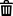

# Personalizar os URLs de rastreamento para criações em uma experiência com direcionamento de árvore de decisão

*Nós do Target somente com criações existentes*

Para experiências com direcionamento de árvore de decisão, é possível criar até cinco URLs de rastreamento de impressão personalizados e cinco URLs de rastreamento de cliques personalizados para cada criativo individual usado para a experiência. Quando a substituição da página de aterrissagem está disponível, você também pode especificar um URL de página de aterrissagem personalizado. Você pode personalizar os URLs de rastreamento em qualquer editor de árvore de decisão.

As URLs personalizadas são usadas apenas para anúncios criados a partir da experiência e não são salvas nas configurações básicas de criação no [!UICONTROL Creative Libraries].

A substituição da página de aterrissagem está disponível para experiências padrão e para nós que usam criações padrão. Para pacotes dinâmicos atribuídos, as páginas de aterrissagem são determinadas pelo feed e a guia da página de aterrissagem não é exibida.

## Uso do editor orientado por IA (Beta) {#ai-editor}

Enquanto você está [criando](experience-create-targeting.md#ai-editor) ou [editando](experience-edit-targeting.md#ai-editor) a experiência, use os controles da tela:

1. No nó folha criativa abaixo do nó de destino, clique em **[!UICONTROL ...]** > **[!UICONTROL Edit Tracking URLs]**.

1. Selecione a guia **[!UICONTROL Click Tracking URLs]**, **[!UICONTROL Impression Tracking URLs]** ou (quando disponível) **[!UICONTROL Landing URL]**.

   As criações são agrupadas por pacote. Os tamanhos criativos padrão da experiência determinam os tamanhos criativos disponíveis.

1. Expanda o criativo que deseja editar e siga um destes procedimentos:

   * Para adicionar ou editar um URL personalizado, insira o URL no campo de entrada.

   * Para adicionar outra URL de rastreamento personalizada, clique em **[!UICONTROL Add URL]** e insira a URL no campo de entrada.

   * Para remover uma URL personalizada, clique em **[!UICONTROL Delete URL]**.

   Clique fora de um campo editado e corrija quaisquer erros de validação antes de salvar.

1. Clique em **[!UICONTROL Save]** na caixa de diálogo para atualizar a árvore de trabalho.

1. [Salve a experiência](#save) do cabeçalho da árvore.

## Usar o editor manual {#manual-editor}

[Abra o editor manual](experience-edit-targeting.md#experience-open) antes de seguir essas etapas.

1. No nó folha criativa abaixo do nó de destino, clique em **[!UICONTROL ...]** > **[!UICONTROL Edit Tracking URLs]**.

1. Selecione a guia **[!UICONTROL Click Tracking URLs]**, **[!UICONTROL Impression Tracking URLs]** ou (quando disponível) **[!UICONTROL Landing URLs]**.

   As guias listam as criações nos pacotes atribuídos. Os tamanhos de criação padrão da experiência determinam os tamanhos de criação disponíveis.<!-- There's no distinct "Creative Sizes" setting. -->

1. Expanda o criativo que deseja editar e siga um destes procedimentos:

   * Para adicionar ou editar um URL personalizado, insira o URL no campo de entrada.

   * Para adicionar outra URL de rastreamento personalizada, clique em **[!UICONTROL +]** e insira a URL no campo de entrada.

   * Para remover uma URL personalizada, mantenha o cursor sobre a linha criativa e clique em .

1. Clique em **[!UICONTROL Save]** na caixa de diálogo para atualizar a árvore de trabalho.

1. [Salve a experiência](#save) do cabeçalho da árvore.

## Salve a experiência {#save}

As etapas a seguir se aplicam a ambos os editores. Salvar a caixa de diálogo URL de rastreamento sozinho não salva ou publica a experiência.

{{$include /help/_includes/experience-save.md}}

>[!MORELIKETHIS]
>
>* [Atribuir e cancelar atribuição de pacotes criativos a um nó final em uma experiência](/help/creative/experiences/experience-assign-creative-bundles.md)
>* [Personalizar as URLs de rastreamento para uma experiência sem o direcionamento da árvore de decisão](experience-tracking-urls-no-targeting.md)
