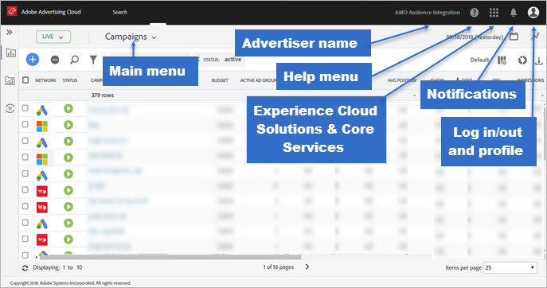

# Como a interface do usuário é organizada

## Nova interface de usuário

*recurso do Beta*

Cada página inclui o menu principal e outros menus baseados em tarefas e informações.

O [perfil de produto](/help/search-social-commerce/user-administration.md#default-product-profiles) determina as opções disponíveis, incluindo a funcionalidade disponível em cada exibição.

## O menu principal

A nova interface de usuário do apresenta um novo menu principal à esquerda, que organiza as tarefas por estágio de trabalho.

### Opções do menu principal

* (Quando aplicável) Uma lista selecionável de anunciantes que você está gerenciando, acima do campo de pesquisa no painel de navegação esquerdo expandido.

* Um campo de pesquisa para opções do menu principal.

* Submenu **[!UICONTROL Dashboard]**:

  * **[!UICONTROL Overview]** Visualize o desempenho de todos os seus portfólios, grupos de portfólios ou objetivos de otimização.

  * **[!UICONTROL Recommendations]**: Liste as recomendações do editor de [!DNL Google Ads] e [!DNL Microsoft Advertising] e os insights do editor de [!DNL Microsoft Advertising.]. Como opção, você pode aplicar as recomendações.

* Submenu **[!UICONTROL Manage]**:

  * **[!UICONTROL Portfolios]:** Lista e gerencia todos os portfólios do anunciante. É possível abrir uma lista de restrições atribuídas e exibir detalhes de desempenho e composição de qualquer portfólio.

    As configurações do portfólio incluem guias para atribuir o objetivo e as campanhas, gerenciar gastos, gerenciar restrições e controlar a otimização. Somente usuários com o perfil de &quot;otimização de especialista&quot; ou superior podem editar as configurações na guia [!UICONTROL Control Optimization].

  * **[!UICONTROL Networks]**: (Somente leitura) Visualize o custo, os cliques, o custo por clique (CPC), as impressões e o valor objetivo para cada combinação de rede de anúncios e moeda que é sincronizada por meio de uma conexão de API ou configurada por meio de carregamento de dados.

  * **[!UICONTROL Accounts]**: liste e gerencie contas de rede de anúncios que são sincronizadas por meio de uma conexão de API ou configuradas por meio de carregamento de dados. Você também pode gerenciar contas existentes do [!UICONTROL Naver].

  * **[!UICONTROL Campaigns]:** Lista e gerencia todas as campanhas para o anunciante. Você pode atribuir campanhas a portfólios e gerenciar atribuições de rótulos e restrições para campanhas selecionadas. Além disso, você pode replicar [!DNL Google Ads] campanhas em [!DNL Microsoft Advertising].

  * **[!UICONTROL Ad Groups]:** Lista e gerencia todos os grupos de anúncios do anunciante. Você pode gerenciar atribuições de etiquetas e restrições para grupos de anúncios selecionados.

  * **[!UICONTROL Ads]** Liste e gerencie todos os anúncios do anunciante. É possível gerenciar atribuições de etiquetas e restrições para anúncios selecionados.

  * **[!UICONTROL Keywords]** Liste e gerencie palavras-chave existentes e negativas para o anunciante. Você pode gerenciar atribuições de rótulo e restrição para palavras-chave selecionadas.

  * **[!UICONTROL Product Groups]** Liste e gerencie seus grupos de produtos de compras existentes. Você pode gerenciar atribuições de etiquetas e restrições para grupos de produtos selecionados.

* Submenu **[!UICONTROL Reports]**:

  * **[!UICONTROL Insights]**: Gerar dados visuais e acionáveis para ajudá-lo a avaliar o desempenho do portfólio, identificar problemas de otimização e comparar dados de conversão.

  * **[!UICONTROL Reports]**: Gerar e gerenciar relatórios e modelos de relatório personalizados.

  * **[!UICONTROL Spreadsheet Feeds]**: Exibir e configurar feeds de relatório para serem atualizados diariamente.

  * **[!UICONTROL History Logs]**: exibir alterações recentes na conta do anunciante.

* Submenu **[!UICONTROL Plan]**:

  * **[!UICONTROL Simulations]** Liste todas as simulações personalizadas criadas pelo usuário e as simulações semanais geradas automaticamente, gere novas simulações personalizadas e execute novamente as simulações existentes.

  * **[!UICONTROL Spend Planner]** Gere e aplique recomendações de orçamento de portfólio para uma distribuição de gastos ideal entre seus portfólios.

* Submenu **[!UICONTROL Set Up]**:

  * **[!UICONTROL Bulksheets]**: baixe e carregue arquivos de bulksheet contendo dados de campanha para suas redes de anúncios.

  * **[!UICONTROL Label Classification]** Liste e gerencie classificações, incluindo atribuição/desatribuição de valores de classificação a campanhas e componentes da campanha.

  * **[!UICONTROL Manager Accounts]**: liste e gerencie contas de gerente em suas redes de anúncios.

* Submenu **[!UICONTROL Goals]**:

  * **[!UICONTROL Objectives]** Liste e gerencie os objetivos de otimização.

  * **[!UICONTROL Conversions]** Liste as métricas de conversão rastreadas do anunciante e personalize as métricas disponíveis para exibições de gerenciamento e relatórios.

  * **[!UICONTROL Conversion Value Rules]** Liste e gerencie regras de valor de conversão no nível da campanha e da conta para contas do [!DNL Google Ads].

  * **[!UICONTROL Constraints]** Lista e gerencia restrições de licitação.

* Submenu **[!UICONTROL Targeting]**:

  * **[!UICONTROL Audiences]**: liste e gerencie públicos, públicos-alvo e exclusões de público.

  * **[!UICONTROL Auto Targets]** Liste e gerencie destinos automáticos. Você pode gerenciar atribuições de rótulo e restrição para alvos automáticos selecionados.

  * **[!UICONTROL Placements]** Liste e gerencie seus posicionamentos e posicionamentos negativos. É possível gerenciar atribuições de rótulo e restrição para disposições selecionadas.

* Submenu **[!UICONTROL Library]**:

  * **[!UICONTROL Assets]** Liste e gerencie seus ativos criativos.

  * **[!UICONTROL Extensions]** Liste e gerencie suas extensões de chamada, extensões de sitelink e associações entre suas extensões de anúncios e entidades de conta.

  * **[!UICONTROL Products]** Abre exibições somente leitura de suas contas e produtos da central de comércio existentes. Para adicionar uma conta do centro de comércio, use a exibição herdada [!UICONTROL Campaigns] > [!UICONTROL Products]. Retorne à interface herdada clicando no botão [[!UICONTROL Switch to Old UI]](/help/search-social-commerce/getting-started/ui-switch.md).

<!--
 What's happening to these?

Tools > Generic Tracking
Tools > Inventory Selection
Tools > Admin > Data Source Setup
-->

### Recolher o menu principal

Recolha o menu principal quando quiser mais espaço para exibir dados.

* Acima do menu principal à esquerda, clique em .

### Exibir dados de outro anunciante

* Expanda o painel de navegação esquerdo se ele estiver recolhido. Acima do campo de pesquisa, abra a lista de anunciante e selecione o anunciante.

  Para obter detalhes e restrições, consulte &quot;[Exibir dados de outro anunciante](/help/search-social-commerce/common-tasks/change-advertiser.md)&quot;.

### Procurar opções do menu principal

Use o campo de pesquisa acima do menu principal para procurar opções de menu específicas, como &quot;Portfólios&quot; ou &quot;Relatórios&quot;.

## Outros menus na parte superior direita, baseados em tarefas e informações

### Linha superior: menu CX Enterprise

* Uma lista selecionável de organizações da CX Enterprise às quais você tem acesso.

*  Um menu de ajuda que inclui links para a documentação e outras informações.

*  Um painel que lista solicitações, notificações e anúncios da CX Enterprise.

*  Uma lista de soluções e serviços da Adobe CX Enterprise para os quais você pode alternar.

*  Informações sobre o perfil da sua conta da CX Enterprise, a partir da qual você pode editar suas preferências e sair.

### Segunda linha: menu adicional de Pesquisa, Social e Commerce

**Observação:** algumas telas têm opções adicionais.

* O intervalo de datas configurável para a exibição atual. Quando a comparação de datas é suportada, o controle de intervalo de datas também permite que você compare dois períodos e escolha se deseja mostrar a alteração como uma porcentagem ou uma variação numérica. Consulte &quot;[Filtrar dados por intervalo de datas](/help/search-social-commerce/common-tasks/data-views/ad-hoc-settings/date-filter.md#date-filter-new-ui)&quot;.

*  Abre a interface herdada em uma nova guia ou janela.

*  Permite criar ou exibir alertas personalizados em um painel.

*  Abre uma lista de <!--what kind --> trabalhos de operação em massa.

*  Abre um painel listando suas notificações de Pesquisa, Social e Commerce. Você pode filtrar a lista, editar suas configurações de notificação ou abrir o [!UICONTROL Notification Center].m

## Interface do usuário herdada

A parte superior de cada página inclui o menu principal e outros menus baseados em tarefas e informações.

### O menu principal

* **[!UICONTROL Search, Social, & Commerce]** \> — Para gerenciar suas contas de rede de anúncios no Search, Social e Commerce, incluindo contas para as quais o Search, Social e Commerce está rastreando, mas não está oferecendo.

### [!UICONTROL Search] menus

A opção [!UICONTROL Search] inclui os submenus a seguir. Sua função determina as opções disponíveis:

* **[!UICONTROL Campaigns]** — Esse menu inclui opções para exibir e gerenciar informações sobre as contas de anúncios e campanhas que você está gerenciando ou rastreando. Dependendo da rede de publicidade e de sua função, talvez seja necessário criar e editar contas e campanhas e seus componentes. Você também pode gerenciar classificações de etiquetas, que podem ser atribuídas a vários componentes de conta.

* **[!UICONTROL Optimization]** — Este menu tem opções para gerenciar objetivos de negócios, gerenciar portfólios com base em seus objetivos de negócios e monitorar o desempenho do portfólio, gerar o [!UICONTROL Spend Recommendation Report] entre portfólios, gerenciar restrições de lances e exibir e (alguns usuários) gerenciar suas regras de valor de conversão do [!DNL Google Ads].

  A documentação separada sobre estes recursos está disponível no menu [!UICONTROL Help] ().

* **[!UICONTROL Insights & Reports]** — Esse menu inclui opções para gerar insights e relatórios detalhados, automatizar a produção de relatórios usando feeds de planilhas, criar e monitorar alertas, definir as configurações de notificação, exibir recomendações de rede e exibir um log de alterações feitas na conta do anunciante.

* **[!UICONTROL Tools]** — Esse menu inclui opções para alterar a senha da conta, gerar tags para rastrear conversões de páginas do site, gerar e decodificar URLs de rastreamento de cliques e carregar métricas para campanhas de rastreamento de pesquisa.

* **[!UICONTROL Admin]** — O menu [!UICONTROL Admin] inclui opções para alterar os nomes para exibição das métricas de conversão de um anunciante em tabelas de dados e relatórios, definir as configurações para sincronização com uma conta do Adobe Audience Manager e sincronizar métricas de conversão para uma conta, propriedade e combinação de exibição específica do [!DNL Google Analytics]. Dependendo da sua função, ela pode permitir gerenciar contas de anunciante, contas de agência, funções de usuário e contas de usuário.

### Outros menus à direita, baseados em tarefas e informações

* (Quando aplicável) Uma lista selecionável de anunciantes que você está gerenciando.

*  Um painel que lista suas notificações de pesquisa, sociais e Commerce.

  Quando você estiver [conectado por meio do Adobe CX Enterprise](sign-in.md), este painel mostrará as notificações da CX Enterprise.

*  Um menu de ajuda que inclui links para a documentação e outras informações.

*  Uma lista de soluções e serviços da Adobe CX Enterprise para os quais você pode alternar.

*  Um link para o seu perfil, do qual você pode sair.

  Quando você estiver [conectado por meio do Adobe CX Enterprise](sign-in.md), também poderá editar seu perfil do CX Enterprise, incluindo sua senha do CX Enterprise e configurações de notificação.

>[!MORELIKETHIS]
>
>* [Entrar](sign-in.md)
>* [Sair](sign-out.md)
>* [Alternar entre a nova interface e a interface herdada](ui-switch.md)